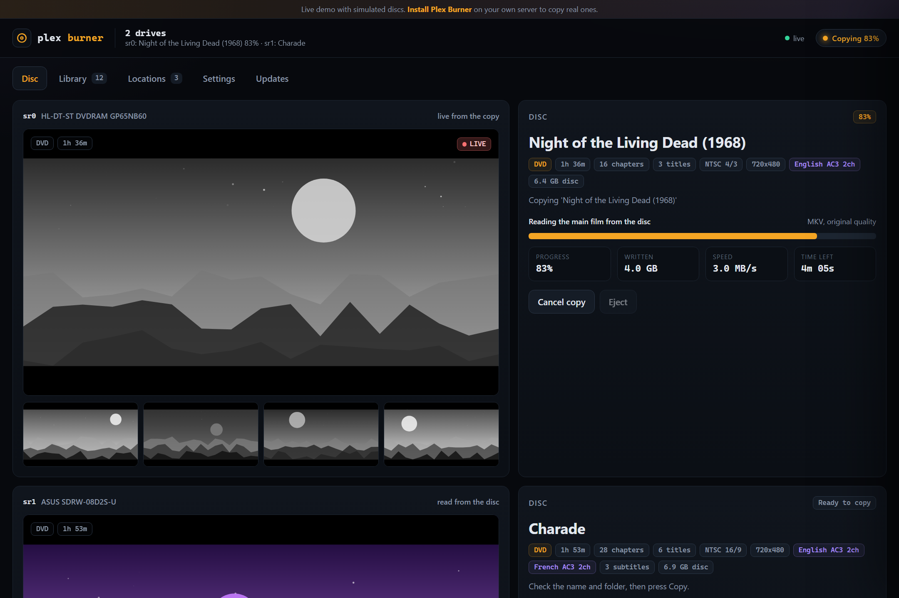
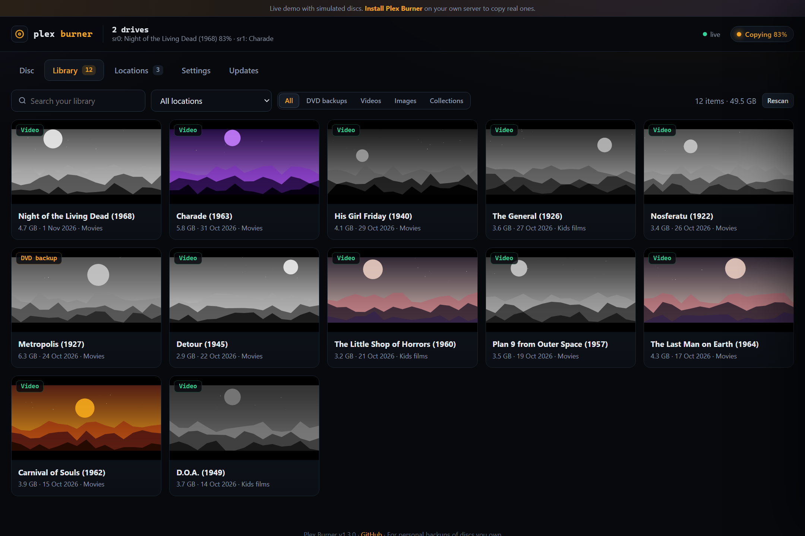
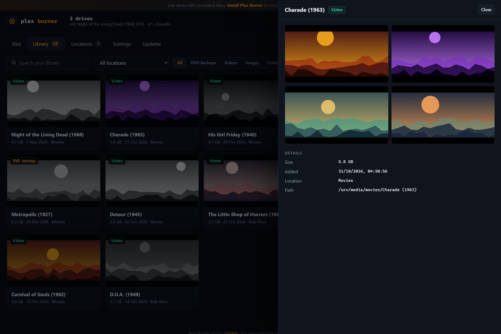
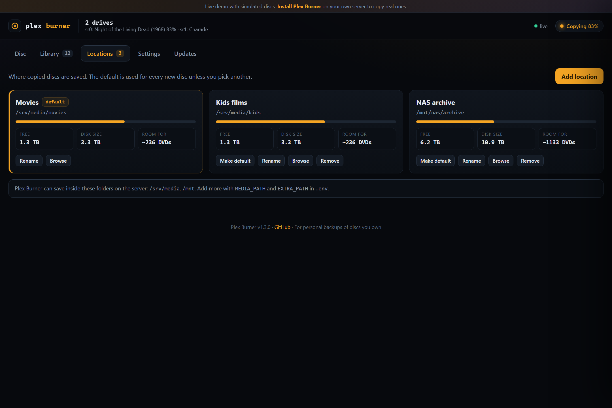
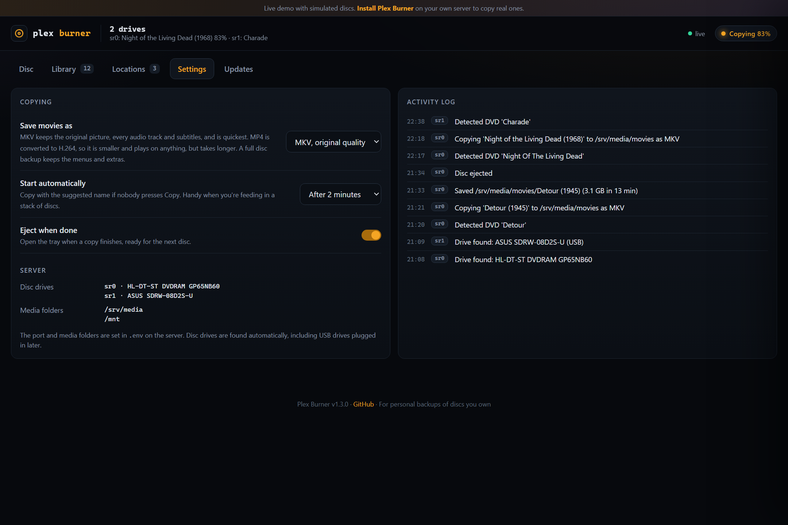

<div align="center">

# 💿 Plex Burner

**Your DVD shelf, streaming in Plex. Insert a disc, name it, done.**

A self-hosted Docker app that turns the DVD drive in your home server into a ripping station. It detects each
disc, shows you preview frames and suggests a name, saves it to your library as MKV or MP4, then ejects it for the
next one. Works with Plex, Jellyfin, Emby, Kodi and VLC, with as many drives as you plug in.

[**Live demo**](https://bhxuk.github.io/Plex_burner/demo/) ·
[**Website**](https://bhxuk.github.io/Plex_burner/) ·
[Install](#install) ·
[Changelog](CHANGELOG.md)



</div>

## Features

| Tab | What it does |
|---|---|
| **Disc** | One card per drive. Disc title, running time, chapters, audio and subtitles, preview frames read from the disc, a name box and folder picker, then live progress with a picture from the copy, speed and time left |
| **Library** | Everything in your save locations with preview frames, search and filters, including films you already had |
| **Locations** | Save folders with free space and how many more DVDs fit. Browse the server, create folders, set a default |
| **Settings** | Output format (MKV, MP4 or full disc backup), auto-start delay, eject when done, and the activity log |
| **Updates** | Checks GitHub and installs updates with one click, then restarts itself. Never while a disc is copying |

**What gets saved**

- **Movie DVDs:** the main film as **MKV** at original quality with every audio track and subtitle, or as **MP4**
  (H.264 and AAC) that plays on anything. A full disc backup with menus is also available.
- **Home video discs** from DVD recorders and camcorders: their videos are converted to MKV or MP4.
- **Other data discs:** saved as a folder of their files.

Each copy goes in its own folder named after the film, for example `Movies/Charade (1963)/Charade (1963).mkv`,
which is the layout Plex, Jellyfin and Emby expect.

**Several drives:** every DVD drive is found automatically, including USB drives plugged in later, and each one
copies in parallel.

<table><tr>
<td></td>
<td></td>
</tr><tr>
<td></td>
<td></td>
</tr></table>

## Install

Requirements: a Linux server with Docker and Docker Compose v2, and a DVD drive (internal or USB).

```bash
git clone https://github.com/bhxuk/Plex_burner
cd Plex_burner
cp .env.example .env
nano .env                 # set MEDIA_PATH to your media folder
docker compose up -d
```

The first build takes a few minutes while it installs ffmpeg and the DVD libraries. Then open
`http://<server-ip>:9000`, check your save folder on the **Locations** tab, and insert a disc.

The container can only use optical drives (block devices with major number 11) and the folders you give it.
Your clone is mounted into the container so the in-app updater can pull new versions into it.

## Updating

Open the **Updates** tab. When a new version is out you will see a badge and an **Update** button. Plex Burner then:

1. fetches the latest code from GitHub and fast-forwards your install,
2. installs any new Python packages,
3. restarts itself (Docker's restart policy brings it straight back), and the page reloads.

Updates wait until no disc is copying. Set `AUTO_UPDATE=true` to install new versions automatically. Your settings
live in `.env` and the `data` folder, which updates never touch. If a release changes the Docker image (the changelog
says so), run `docker compose up -d --build` once.

Manual alternative: `git pull && docker compose up -d --build`.

## Configuration

Output format, auto-start, eject and save locations are set in the app. Start-up options go in `.env`, followed by
`docker compose up -d`:

| Variable | Default | What it does |
|---|---|---|
| `PORT` | `9000` | Port the dashboard listens on |
| `MEDIA_PATH` | `/srv/media` | Your media folder. Plex Burner can browse and save anywhere inside it |
| `EXTRA_PATH` | `/mnt` | A second folder it may use, for extra drives or network shares |
| `PUID` / `PGID` | `1000` / `1000` | Owner given to copied files. Run `id` on the server to see yours |
| `DISC_DEVICES` | all drives | Only use these drives, for example `sr0,sr1` |
| `UPDATE_CHECK_HOURS` | `6` | How often to check GitHub for a new version |
| `AUTO_UPDATE` | `false` | Install new versions automatically |

Settings, saved locations, copy history and cached preview frames are in `./data`.

## Good to know

- **Keep it on your LAN.** There is no login. For remote access use Tailscale or another VPN, not port forwarding.
- **Space:** a DVD is about 4 to 8 GB as MKV and roughly half that as MP4. The Locations tab shows how many more fit.
- **Audio CDs** are not supported yet.
- **Your own discs:** Plex Burner is for personal backups of discs you own. Copying encrypted DVDs is allowed in some
  countries and not others, so check the rules where you live.

Not affiliated with Plex, Inc.
